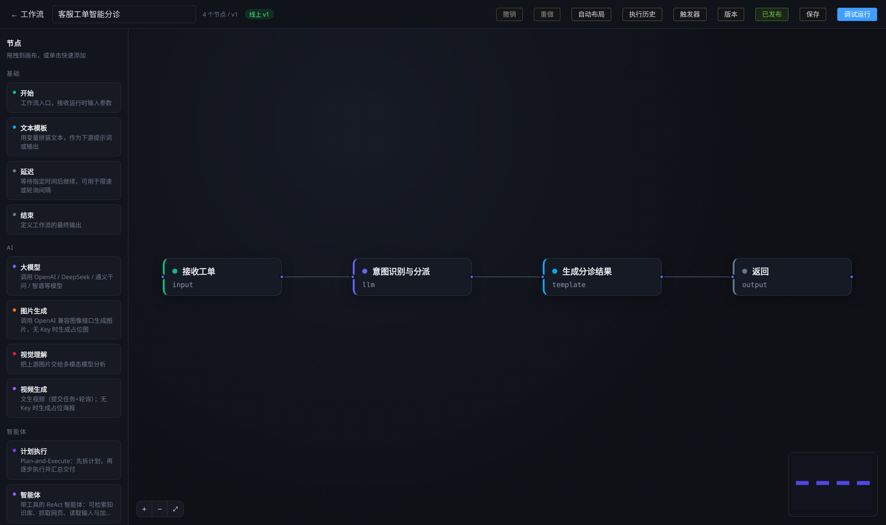

# AgentFlow

参考 PaiAgent 重构的 AI 工作流编排平台：**AI 能力交给 Python + LangGraph + FastAPI，业务与平台能力交给 Java Spring Boot**，前端使用 Vue 3。

## 界面预览

| 可视化编排（发布版本、节点配置） | 执行留痕（节点级输出与 token） |
| --- | --- |
|  |  |

| 工作流列表 | 8 节点数据管道 |
| --- | --- |
|  |  |

> 截图由 `frontend/scripts/capture-docs.mjs` 对本地整栈生成，演示数据由 `e2e/seed_demo.py` 灌入，
> 可以随时重跑得到一致画面，不依赖手工摆拍。

## 为什么拆成两个服务

PaiAgent 把 DAG/LangGraph 引擎、模型调用和业务 CRUD 都塞在 Spring Boot 里。AgentFlow 做如下切分：

| 关注点 | 归属 | 说明 |
| --- | --- | --- |
| 图编排 / 节点执行 / 模型调用 / 技能加载 | ai-service (Python) | LangGraph 原生生态，节点扩展只写 Python |
| 用户认证 / 工作流 CRUD / 执行记录 / 权限 | java-service (Java) | Spring Boot + MyBatis-Plus + MySQL，稳定的事务与后台能力 |
| 可视化编排 | frontend (Vue 3) | Vue Flow + Element Plus |

两个服务之间只有一条契约：**工作流 JSON + SSE 事件流**（见 docs/api-contract.md）。Java 不碰模型 SDK，Python 不碰数据库。

```
Vue 3 ──REST/SSE──> Java (8084) ──REST/SSE──> Python (8000)
  │                    │
  │                    └── MySQL: user / workflow / execution_record / node_definition
  └── Vue Flow 画布
```

## 目录结构

```
agent-flow/
├── ai-service/          # Python 3.11+ / FastAPI / LangGraph
│   ├── app/
│   │   ├── graph/       # LangGraph 构图与运行器
│   │   ├── nodes/       # 节点执行器（AI / 数据 / 文件 / 记忆 / 联网 / 控制流）
│   │   ├── llm/         # OpenAI 兼容模型工厂 + 厂商注册表（含 StepFun / APIFree / 火山方舟）
│   │   ├── skills/      # SKILL.md 三级渐进式加载
│   │   └── api/         # REST + SSE
│   └── tests/
├── java-service/        # Spring Boot 3.4 / Java 21
│   └── src/main/java/com/agentflow/
├── frontend/            # Vue 3 + TS + Vue Flow + Element Plus
└── docs/                # 架构、协议、部署
```

## 快速开始（本地三端）

前置：JDK 21+、Maven 3.9+、Python 3.11+、Node 20+。

### 一键启动（推荐）

依赖装好后，仓库根目录执行：

```bash
./start.sh                  # 启动 AI + Java + 前端，Ctrl+C 一起停止
./start.sh status           # 查看三端健康状态
./start.sh stop             # 停止脚本启动的进程
python3 e2e/seed_demo.py    # 可选：灌入两条演示工作流、发布版本与执行记录
```

想用独立数据库录屏或压测，可以指定数据目录，不影响 `./data` 里的日常数据：

```bash
H2_PATH=/tmp/agentflow-demo/agentflow ./start.sh
```

日志统一写入 `logs/`（`ai.log` / `java.log` / `web.log`）。

### 手动分别启动

### 1. AI 服务（8000）

```bash
cd ai-service
python3 -m venv .venv && source .venv/bin/activate
pip install -e ".[dev]"
cp .env.example .env          # 可选；也可以启动后在页面「模型配置」里填 Key
uvicorn app.main:app --reload --port 8000
```

### 2. Java 服务（8084）

```bash
cd java-service
cp .env.example .env
mvn spring-boot:run           # 默认 local profile，H2 文件库（./data），免装 MySQL
```

生产用 MySQL：--spring.profiles.active=mysql，先执行 docs/schema.mysql.sql。

### 3. 前端（5173）

```bash
cd frontend
npm install
cp .env.example .env.local
npm run dev
```

打开 http://localhost:5173 ，默认账号 admin / admin123。

### Docker Compose

```bash
docker compose up --build
# web: http://localhost:8080  api: http://localhost:8084
# 数据落在命名卷（java-data / ai-data），`docker compose down -v` 彻底清空
# 可用 .env 传入 OPENAI_API_KEY / AI_INTERNAL_TOKEN / CORS_ALLOWED_ORIGINS / CRYPTO_KEY / APP_AUTH_DEFAULT_PASSWORD 等
```

## 测试

```bash
make install-sdk  # 首次运行 SDK 测试前安装开发依赖
make test
make test-sdk     # 仅测试 Python / TypeScript / Java SDK
make check        # 全部测试 + 前端/SDK 类型检查 + 构建
make e2e          # 对已启动的整栈运行后端冒烟
make e2e-service  # API Key、同步执行、OpenAPI 接入验证
make e2e-translations # 图片翻译节点和实时语音翻译 WebSocket 链路（显式 mock）
make e2e-ui       # Playwright 浏览器测试
make test-web     # 前端 SSE 单元回归（无需浏览器和后端）
make test-ui      # 编辑/保存/调试隔离回归（mock API，自动启动前端，无需后端）
```

当前 `make test` 共 **531 个用例**：AI 服务 309、Java 服务 116、前端 SSE 13、Python SDK 47、TypeScript SDK 25、Java SDK 21（不包含整栈冒烟与 UI 测试）。涵盖编排、节点执行、百炼翻译协议与票据、数据转换与校验、MCP / Skills 接入、长期记忆、权限隔离、排队取消、任务拒绝收尾、崩溃恢复、调度租约、SSE 边界与 SDK 接入。

覆盖率与性能基线（本机单实例，可复现）：

```bash
make coverage   # AI 服务语句 77% / 分支 81%；Java 服务行 48% / 分支 40%
make bench      # 并发 20：129 req/s、P95 232 ms（3 节点流程，无模型调用）
```

CI 对覆盖率设了门槛（AI 70%、Java 行 40%），低于门槛直接失败。用例数与覆盖率只说明测试触达范围，不代表真实模型效果或生产容量；压测口径与边界见 [本地性能基线](docs/benchmark.md)。

前端隔离浏览器回归与真实整栈冒烟分开运行，首次使用需在 `frontend/` 执行 `npx playwright install chromium`。详见 [编辑与调试可靠性打磨](docs/editor-reliability.md)。

## 作为服务调用

AgentFlow 既可作为带界面的应用使用，也可作为后端服务被其他程序直接调用。后端 REST API 运行在 Java 服务的 8084 端口（默认），所有接口以 /api 为前缀，统一返回 { code, message, data }。

### 认证

支持两种鉴权方式，请求时二选一：

- API Key（推荐用于服务间调用）：在请求头携带 X-API-Key: af_xxxx。API Key 由管理员通过 POST /api/api-keys 创建，明文仅在创建时返回一次，之后库中以哈希存储，可在 /api/api-keys 查看掩码列表或 DELETE 吊销。
- 服务账号 JWT：先 POST /api/auth/login 用账号密码换取 token，再在请求头携带 Authorization: Bearer <token>。

### OpenAPI 文档

启动后访问 http://<host>:8084/swagger-ui.html 查看全部端点与字段说明；机器可读的契约在 /v3/api-docs。

### 官方 SDK

为方便不同技术栈的服务接入，AgentFlow 提供三种官方 SDK，接口形态一致（认证 → 工作流 / 知识库 / 技能 → 同步或流式执行）：

| SDK | 目录 | 安装 | 适用场景 |
| --- | --- | --- | --- |
| Python | [`sdk/python`](sdk/python/README.md) | 仓库根目录 `pip install -e ./sdk/python` | 数据/算法脚本、后端服务快速集成 |
| TypeScript | [`sdk/typescript`](sdk/typescript/README.md) | 构建后从本地路径或 `npm pack` 产物安装 | Node 服务、前端构建期校验 |
| Java | [`sdk/java`](sdk/java/README.md) | `mvn -f sdk/java/pom.xml install` 后引入依赖 | Spring Boot / 既有 Java 后端 |

SDK 当前随源码提供，尚不以公共包仓库发布为前提；请勿直接安装公共仓库中的同名包。

三种 SDK 均已支持 MCP 配置 / 工具发现 / 授权和 Skills 保存 / 引用资料等管理接口；方法对照、凭据更新语义与可运行示例见 [程序化配置 MCP 与 Skills](docs/sdk-integrations.md)。

三种 SDK 都做三件事：统一注入 `X-API-Key`（或 JWT Bearer）；自动解包 `{ code, message, data }` 响应；把 SSE 流封装成「同步汇总结果」与「逐事件回调 / 异步迭代器」两种执行模式。

#### Python

    from agentflow import AgentFlowClient

    client = AgentFlowClient("http://127.0.0.1:8084", api_key="af_xxxx")
    # 同步执行，返回汇总结果（status / outputs / nodeStatus）
    result = client.workflows.run(workflow_id, input={"topic": "LangGraph"})
    print(result["status"], result["outputs"])
    # 如需实时进度，用流式接口
    for event, payload in client.workflows.execute_stream(workflow_id, input={}):
        print(event, payload)

#### TypeScript

    import { AgentFlowClient } from "agentflow-sdk";

    const client = new AgentFlowClient("http://127.0.0.1:8084", { apiKey: "af_xxxx" });
    // 同步执行，返回 data 节点（runId / status / outputs / nodeStatus）
    const result = await client.workflows.run(workflow_id, { topic: "LangGraph" });
    console.log(result.status, result.outputs);
    // 流式执行：异步迭代器逐个产出 SSE 事件（[event, data] 元组）
    for await (const [event, data] of client.workflows.executeStream(workflow_id, {})) {
      console.log(event, data);
    }

#### Java

    import com.agentflow.sdk.AgentFlowClient;
    import com.agentflow.sdk.AgentFlowClient.Event;

    AgentFlowClient client = new AgentFlowClient("http://127.0.0.1:8084", "af_xxxx");
    // 同步执行，返回 data 节点（JsonNode）
    var result = client.runWorkflow(workflowId, Map.of("topic", "LangGraph"));
    System.out.println(result.get("status"));
    // 流式执行：每个 SSE 事件通过 Consumer 回调
    client.executeWorkflowStream(workflowId, Map.of(),
        (Event e) -> System.out.println(e.name() + " " + e.data()));

### 同步 vs 流式执行

- POST /api/workflows/{id}/run：同步执行，内部消费 SSE 流并在结束后返回 JSON 汇总（runId / status / outputs / nodeStatus / elapsedMs / errorMessage）。适合只关心最终结果的调用方。
- POST /api/workflows/{id}/execute：保持 SSE 流式，适合需要实时节点进度的调用方或前端。

### 管理接口（仅管理员）

- POST /api/api-keys：创建 API Key（body: { name, ownerUserId?, expiresAt? }），返回一次性明文。
- GET /api/api-keys：列出已创建的 Key（掩码）。
- DELETE /api/api-keys/{id}：吊销。

## 核心能力

- **可视化编排**：拖拽节点、连线、节点级参数配置、画布自动布局
- **LangGraph 引擎**：按 JSON 动态构图，支持条件分支、异步节点、自定义事件流
- **多模型统一**：OpenAI / DeepSeek / 通义 / 智谱 / AiPing / StepFun / APIFree（含 SkyClaw）/ 火山方舟；对话走 OpenAI 兼容协议，新增厂商只加一条 providers 配置
- **知识库 / RAG**：文档导入、分片预览、索引与检索，`knowledge` 节点可直接引用片段；`knowledge_upsert` 支持运行期写入并按标题覆盖、立即建索引
- **RAG 增强节点**：多路召回（RRF 融合）、HyDE、LLM 重排、引用式问答，与知识检索/写入组成可编排的完整链路，见 [RAG 节点](docs/rag-nodes.md)
- **长期记忆**：`memory_write` / `memory_retrieve` 支持工作流 / 用户 / 全局三种范围，向量 + 词法混合召回；大模型节点可按提示词自动召回，召回失败不阻断执行；「记忆」页可按范围查看与删除
- **联网检索**：`web_search` 支持 Tavily 直连或 MCP 搜索工具，`web_fetch` 支持多地址抓取、HTML 转纯文本与内网地址拦截
- **智能体节点**：ReAct 工具循环，内置读取输入、加载技能、知识检索、网页抓取、联网搜索（需 Tavily Key）
- **Agent 范式节点**：计划执行（Plan-and-Execute）、反思迭代（Reflexion）、多智能体讨论、协调执行（Orchestrator-Workers）、结果评审、自洽投票、LLM 意图路由；mock 模式可离线跑通，见 [Agent 范式节点](docs/agent-paradigms.md)
- **人工审批**：`human_approval` 节点创建待办并等待通过 / 驳回，执行级超时自动延长；「审批」页可处理，适合发布、外发等敏感动作前把关
- **多模态节点**：`image_generate` 适配 OpenAI / StepFun / 火山方舟，`video_generate` 适配通用轮询接口 / Agnes / 火山方舟，产物统一走媒体文件代理
- **百炼翻译**：`image_translate` 适配 `qwen-mt-image-2.0`，支持本地图片临时上传、保留排版与 JPG 产物；独立「实时翻译」页面适配 `qwen3.8-livetranslate-flash-realtime`，支持麦克风、原文/译文字幕及译音播放，见 [配置与边界](docs/bailian-translations.md)
- **安全与检索质量**：服务商 Key AES-GCM 落库加密；知识检索混合重排（向量 + 词法）
- **服务商凭据前端可配**：Key / Base URL 在「模型配置」页保存到 Java 库，执行时下发给 AI 服务，环境变量兜底
- **可观测性与成本**：Prometheus 指标（执行/节点耗时、失败率、运行中数量、按模型 token）、执行级 token 与估算成本、日志自动携带 runId
- **版本与发布**：每次保存生成不可变版本快照，支持版本查看/回滚；发布后 Cron / Webhook 固定执行发布版本，编辑器手动运行仍使用当前草稿
- **节点编排**：条件分支、并行扇出 + 合并、延迟、子工作流、循环遍历；节点级重试/超时/失败继续；画布支持撤销重做、多选复制粘贴与拓扑自动布局
- **自动触发**：每个工作流可挂多个触发器——CRON 定时（5/6 段表达式 + 时区）或 Webhook（专属令牌 URL，免登录 POST JSON），执行与其他入口共用记录、取消与留痕
- **文件 IO**：`file_read` / `file_write` / `file_list` 节点读写存储目录，路径支持模板变量与上游产物；文件中心可上传、预览、下载、删除，智能体同样可调用文件工具
- **实用数据节点**：JSON 解析、字段映射、列表筛选/排序/去重、文本处理、CSV 转换、日期时间、数据校验、编码与摘要；无需模型 Key，可串联文件 / HTTP / AI 节点，见 [用法与示例](docs/data-nodes.md)
- **节点插件化**：新增节点 = 一个 NodeExecutor 子类 + 注册表登记
- **技能系统**：SKILL.md + YAML Frontmatter，摘要 → 详情 → 引用三级加载
- **Skills 管理**：管理员可新建 / 编辑 / 导入自定义 SKILL.md，内置技能只读；大模型与智能体节点动态选择挂载技能
- **MCP 接入**：远程 Streamable HTTP 配置、工具发现与逐项授权；支持独立 MCP 工具节点及智能体自动调用，凭据加密、配置按用户隔离，见 [配置说明与边界](docs/mcp-skills.md)
- **实时调试**：节点级 SSE 事件（开始/流式 token/成功/失败），Java 透传并落库
- **执行中心**：全局执行历史、状态筛选、节点输出回看，支持取消运行中的任务与断点续跑（复用已成功节点输出）
- **执行留痕**：每次执行写入 execution_record 与 execution_node_log
- **执行安全与故障收尾**：非管理员仅能查看、取消、删除本人记录；子工作流同样校验归属。排队任务可取消，任务拒绝返回 503 并记录失败，异常中断会收尾未完成节点，避免残留运行中状态
- **崩溃恢复**：启动时把上次进程遗留的 RUNNING 执行与未结束节点统一置为 FAILED 并补齐耗时，避免永久「运行中」的脏数据，见 [可靠性设计](docs/reliability.md)
- **多实例调度去重**：CRON 触发器派发前抢 `scheduler_lock` 表租约（默认 10s，自动过期），多副本不会对同一触发点重复执行
- **资源级归属校验**：工作流、执行记录、知识库及其文档都按归属过滤，越权统一返回 404，避免通过 ID 探测他人资源

## 项目展示与边界

- [简历项目介绍与面试讲解](docs/resume-project.md)：Java 后端版、AI 应用版、技术依据与真实能力边界。
- [本轮完善与验证记录](docs/improvement-report.md)：问题修复、测试结果、后续生产化优先级。
- 当前适合个人项目展示与小规模部署。已具备执行崩溃恢复、CRON 派发租约与知识库归属校验（见 [可靠性设计](docs/reliability.md)），但持久化任务队列、跨实例取消路由、文件目录多租户与 MySQL 实机验证仍需完善，详见部署说明；不要将现有功能等同于已验证的高可用生产系统。

## 文档

- [架构设计](docs/architecture.md)
- [服务间契约](docs/api-contract.md)
- [数据库设计](docs/schema.mysql.sql)
- [部署说明](docs/deploy.md)
- [简历项目介绍](docs/resume-project.md)
- [可靠性设计](docs/reliability.md)
- [本地性能基线](docs/benchmark.md)
- [完善与验证记录](docs/improvement-report.md)
- [编辑与调试可靠性打磨](docs/editor-reliability.md)
- [实用数据与工具节点](docs/data-nodes.md)
- [Agent 范式节点](docs/agent-paradigms.md)
- [人工审批](docs/human-approval.md)
- [RAG 节点](docs/rag-nodes.md)
- [MCP 与 Skills 配置](docs/mcp-skills.md)
- [程序化配置 MCP 与 Skills](docs/sdk-integrations.md)
- [百炼图片与实时语音翻译](docs/bailian-translations.md)

## License

MIT
