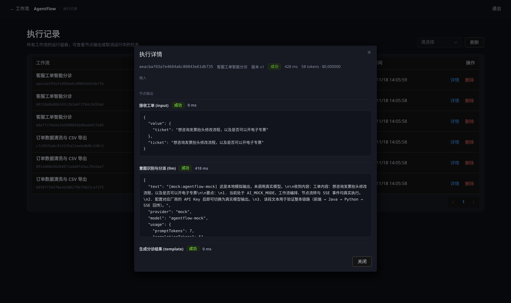
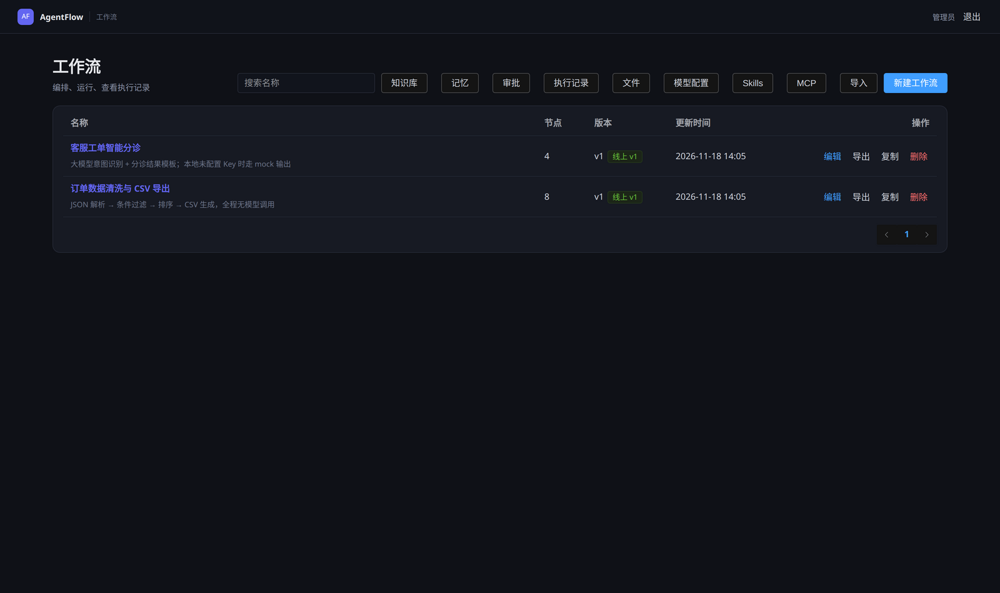
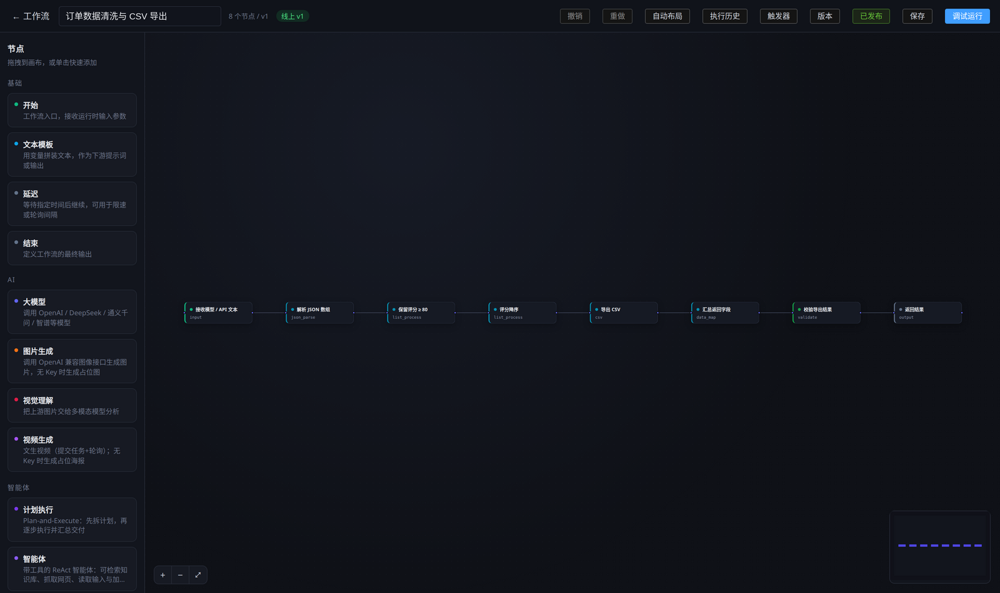

# AgentFlow — 可视化 AI 工作流与智能体编排平台

**把大模型、知识库、工具调用和数据处理串成可执行、可调试、可通过 API 调用的工作流。**

AgentFlow 是一个可本地部署的开源 AI 应用开发项目。你可以在网页画布上拖拽节点、连接处理步骤、配置模型和提示词，再用 JSON 输入运行工作流，实时查看节点输出与执行状态。搭建好的流程既可以在页面中使用，也可以通过 REST API 或 SDK 接入其他应用。

项目采用 **Vue 3 前端 + Python FastAPI 平台服务 + LangGraph 执行引擎**：平台服务管理用户、版本、权限和执行记录，Python 负责模型调用、智能体与工作流运行。

它不是模型训练框架，也不只是一个聊天界面，而是把已有模型能力组织成业务流程的应用层平台。当前适合学习 AI 应用架构、验证业务原型和小规模单实例部署，尚不是经过高可用生产验证的系统。

[快速开始](#快速开始) · [核心能力](#核心能力) · [系统架构](#系统架构) · [API 与 SDK](#api-与-sdk) · [使用边界](#使用边界) · [文档](#文档)

## 可以用它做什么

下面是可用现有节点组合的场景示意，不代表这些流程已全部作为模板内置：

| 场景 | 处理思路 |
| --- | --- |
| 知识库问答 | 输入问题 → 检索文档 → 重排相关片段 → 大模型生成带引用的回答 |
| 联网研究与报告 | 输入主题 → 搜索 / 抓取网页 → 智能体整理资料 → 输出报告 |
| 数据清洗与导出 | 读取文件 / HTTP 数据 → JSON 解析 → 筛选、映射、校验 → 写出 CSV |
| 有人工把关的自动化 | 生成内容 → 人工审批 → 通过后调用 HTTP 接口或写入文件 |
| 多步骤智能体任务 | 制定计划 → 调用工具执行 → 反思或评审 → 汇总结果 |
| 图片与语音翻译 | 图片翻译节点保留原图排版；独立实时翻译页面提供麦克风字幕与译音播放 |

希望给现有 Python、Node.js 或其他 HTTP 服务增加 AI 流程，也可以只使用后端 API，不必嵌入可视化编辑器。

## 界面预览

| 可视化编排与节点配置 | 执行详情与节点输出 |
| --- | --- |
|  |  |

| 工作流列表 | 数据处理管道 |
| --- | --- |
|  |  |

截图来自本地运行的完整应用。演示数据脚本为 `e2e/seed_demo.py`，截图脚本为 `frontend/scripts/capture-docs.mjs`。

## 核心能力

### 工作流搭建与运行

- **可视化编辑**：拖拽连线、节点参数配置、自动布局、撤销重做、复制粘贴。
- **流程控制**：条件分支、并行扇出与合并、循环遍历、子工作流、延迟，以及节点级重试、超时和失败继续。
- **实时调试**：通过 SSE 展示节点开始、流式文本、成功与失败事件；执行中心可回看节点输出、耗时和 token 用量。
- **执行保护**：共用有界执行池、上游连接/读取期限和 SSE 大小限制；Python 限制并发与事件积压，超限明确失败，不静默丢弃 token。
- **版本与触发**：保存版本快照、查看与回滚、发布版本；支持手动执行、API 调用、Cron 定时和 Webhook 触发。自动触发使用发布版本，编辑器运行使用当前草稿。
- **人工审批与续跑**：敏感步骤前加入审批节点；支持取消执行，在显式执行上下文一致时复用成功节点输出续跑，不兼容返回 409。

### AI、知识与工具

| 能力 | 说明 |
| --- | --- |
| 多模型接入 | 对话通过 OpenAI 兼容协议接入 OpenAI、DeepSeek、通义千问、智谱、StepFun、火山方舟等厂商；页面可配置 Key 与 Base URL |
| 智能体 | ReAct 工具循环，以及计划执行、反思迭代、多智能体讨论、协调执行、评审、自洽投票和意图路由节点 |
| 知识库 / RAG | 文档导入与分片、知识检索和写入、多路召回融合、HyDE、LLM 重排及引用式问答 |
| 长期记忆 | 工作流、用户和全局范围的记忆写入与检索，结合向量与词法召回 |
| MCP 工具 | 配置远程 Streamable HTTP 服务、发现工具并逐项授权；可由工具节点或智能体调用 |
| Skills | 基于 `SKILL.md` 的技能加载，支持摘要、正文、引用资料的渐进式读取和自定义技能管理 |
| 联网与数据处理 | 搜索、网页抓取、HTTP 调用、文件读写，以及 JSON、CSV、列表、文本、日期、校验、编码和摘要节点 |
| 多模态 | 图像生成、视频生成、视觉理解和语音合成；不同节点的厂商支持范围不同 |
| 百炼翻译 | 图片翻译适配 `qwen-mt-image-2.0`；独立实时语音翻译页面适配 `qwen3.8-livetranslate-flash-realtime`，支持原文 / 译文字幕与译音 |

### 平台管理

- JWT / API Key 鉴权；工作流、执行记录和知识库的资源归属校验。
- 服务商凭据 AES-GCM 加密存储，API Key 哈希存储。
- 执行记录与节点日志、Prometheus 指标、token 统计与估算成本。
- 异常执行收尾、启动时修复遗留运行状态、基于数据库租约的 Cron 派发去重。

这些能力有各自的实现范围，尤其是文件隔离、跨实例运行和真实模型效果，见下方[使用边界](#使用边界)。

## 系统架构

```text
浏览器：Vue 3 + TypeScript + Vue Flow + Element Plus
                         │
                    REST / SSE
                         ▼
Python 平台服务：FastAPI + SQLAlchemy                 :8084
  用户认证 · 工作流与版本 · 触发器 · 执行记录 · 对外 API
             │                         │
     工作流 JSON / SSE             SQLite / MySQL
             ▼
Python AI 服务：FastAPI + LangGraph                      :8000
  图编译与执行 · 大模型 · 智能体 · RAG · MCP · Skills
             │
             ▼
       模型厂商 / 外部工具
```

实时语音翻译另有一条 **浏览器 → 平台服务 → Python → 百炼的 WebSocket 链路**，不是持续占用工作流节点的无限时长任务。

| 模块 | 技术栈 | 职责 |
| --- | --- | --- |
| `frontend` | Vue 3、TypeScript、Vue Flow、Element Plus、Pinia、Vite | 可视化画布、配置页面、调试与管理界面 |
| `platform-service` | Python 3.11+、FastAPI、SQLAlchemy | 认证、业务数据、版本发布、调度、权限和执行留痕 |
| `ai-service` | Python 3.11+、FastAPI、LangGraph、LangChain | 工作流 JSON 编译、节点执行、模型与工具调用、事件输出 |
| 数据存储 | SQLite / MySQL（SQLAlchemy 建表） | 用户、工作流、执行记录、知识库等持久化数据 |

拆分的目的，是让 AI 扩展使用 Python 生态，同时将业务事务和权限保留在平台服务。Python 不直接访问业务数据库，知识与记忆通过平台内部 API 读写。新增节点需要补充 Python 执行器、注册和节点目录定义；前端按节点配置 Schema 渲染表单。

详见[架构设计](docs/architecture.md)与[服务间契约](docs/api-contract.md)。

## 快速开始

### 方式一：本地启动

需要 **Python 3.11+、Node.js 20+**，以及 `make`、Bash、`curl`。启动脚本适用于 Linux / macOS；Windows 建议使用 WSL 或下方的 Docker Compose。

```bash
git clone https://github.com/jean3690/agent-flow.git
cd agent-flow

make install       # 安装 Python / 前端依赖，并初始化平台服务虚拟环境
./start.sh         # 启动三端，Ctrl+C 一起停止
```

启动后访问：

| 入口 | 地址 |
| --- | --- |
| 网页应用 | http://localhost:5173 |
| 平台 API | http://localhost:8084/api/system/health |
| OpenAPI 文档 | http://localhost:8084/swagger-ui.html |
| AI 服务健康检查 | http://localhost:8000/health |

默认管理员为 **`admin` / `admin123`**，仅供本地体验。平台服务默认使用 SQLite 文件数据库，自动建表，无需安装 MySQL，重启保留数据。

其他常用命令：

```bash
./start.sh status          # 查看三端健康状态
./start.sh stop            # 停止脚本启动的进程
python3 e2e/seed_demo.py   # 可选：写入两条演示工作流、发布版本与执行记录
```

日志位于 `logs/ai.log`、`logs/platform.log` 和 `logs/web.log`。需要分开启动时，在三个终端分别运行 `make ai`、`make platform`、`make web`。

### 方式二：Docker Compose

安装 Docker 与 Compose 插件后，在仓库根目录运行：

```bash
docker compose up --build
```

网页入口为 **http://localhost:8080**，平台 API 仍在 **http://localhost:8084**。默认使用 SQLite，数据保存在 `platform-data` 与 `ai-data` 命名卷中。停止服务使用 `docker compose down`；加 `-v` 会删除数据卷，请谨慎使用。

### 第一次体验

1. 登录后创建工作流，在画布上添加开始、处理和结束节点，配置参数并连线。
2. 先尝试不依赖模型 Key 的数据处理节点，或用演示脚本创建示例流程。
3. 保存并运行，在调试面板查看实时进度，再到执行中心查看记录。
4. 需要真实 AI 输出时，在「模型配置」页填写对应厂商的 API Key 与 Base URL。
5. 需要定时或 Webhook 调用时，先发布工作流版本，再配置触发器。

**Mock 不等于真实模型调用。** 默认 `AI_MOCK_MODE=auto`，支持 mock 的模型节点在缺少 Key 时可返回模拟结果，方便验证流程；配置真实 Key 后才会调用厂商接口并可能产生费用。实时语音翻译需要真实百炼配置，或显式选择 mock，不会无 Key 自动假装翻译。

本地 AI 环境配置可参考 `ai-service/.env.example`；平台配置可参考 `platform-service/.env.example`。百炼翻译还需要匹配地域的业务空间 Host，具体见[图片与实时语音翻译配置](docs/bailian-translations.md)。不要将真实 Key 提交到仓库。

## API 与 SDK

工作流可以作为后端能力调用。平台服务对外业务接口以 `/api` 为前缀，普通 JSON 响应采用 `{ code, message, data }` 格式；执行还支持 SSE 流式返回。

| 接口 | 用途 |
| --- | --- |
| `POST /api/workflows/{id}/run` | 同步执行，返回最终状态、输出、节点状态与耗时 |
| `POST /api/workflows/{id}/execute` | SSE 流式执行，实时接收节点进度与文本事件 |
| `POST /api/executions/{runId}/cancel` | 请求取消执行；关闭 SSE 连接不等于取消后台任务 |

鉴权可以二选一：

- **API Key**：携带 `X-API-Key` 请求头；管理员通过 `POST /api/api-keys` 创建，明文只返回一次，支持列出掩码与吊销。
- **JWT**：通过 `POST /api/auth/login` 获取 token，携带 `Authorization: Bearer <token>`。

项目提供随源码维护的两种 SDK，支持认证、工作流执行，以及知识库、MCP、Skills 等管理接口：

| SDK | 安装 / 接入说明 |
| --- | --- |
| Python | [Python SDK](sdk/python/README.md)，可用 `pip install -e ./sdk/python` 本地安装 |
| TypeScript | [TypeScript SDK](sdk/typescript/README.md)，构建后使用本地路径或打包产物 |

**请勿假定公共包仓库中的同名包属于本项目。** 完整调用示例见各 SDK README；MCP / Skills 的程序化配置见[SDK 集成文档](docs/sdk-integrations.md)。接口定义可在启动后的 Swagger 页面或 `/v3/api-docs` 查看。

## 目录结构

```text
agent-flow/
├── ai-service/          # Python AI 执行服务
│   ├── app/graph/       # LangGraph 图编译与运行
│   ├── app/nodes/       # AI、工具、数据与控制流节点
│   ├── app/llm/         # 模型厂商与客户端适配
│   ├── app/skills/      # 技能加载与内置技能
│   └── tests/           # AI 服务测试
├── platform-service/        # 业务 API、认证、调度与持久化
├── frontend/            # 可视化编辑与管理界面
├── sdk/                 # Python / TypeScript 客户端
├── e2e/                 # 整栈验证、演示数据与性能测试
├── docs/                # 架构、功能说明、部署与截图
├── docker-compose.yml   # 容器化本地部署
├── Makefile             # 安装、测试与构建入口
└── start.sh             # 本地三端启动脚本
```

## 开发与测试

在完成 `make install` 后，可使用以下入口：

```bash
make install-sdk       # 首次安装 SDK 开发依赖
make test              # AI、平台、前端单元与两种 SDK 测试
make check             # 全部测试、类型检查与构建
make coverage          # 生成 AI / 平台覆盖率报告
```

浏览器测试首次需要在 `frontend/` 安装 Chromium：

```bash
cd frontend
npx playwright install chromium
cd ..
make test-ui           # 隔离浏览器回归：mock API，无需后端
```

完整应用已启动后，可进一步运行：

```bash
make e2e               # 后端整栈冒烟
make e2e-service       # API Key、同步执行与 OpenAPI 验证
make e2e-translations  # 图片 / 语音翻译链路验证，显式 mock
make e2e-ui            # 整栈浏览器测试
make bench             # 对运行中的服务进行并发压测
```

自动化测试覆盖图编排、节点行为、权限、执行收尾、SSE、翻译协议和 SDK 等。用例数与覆盖率以实际运行结果为准；mock 验证不代表真实模型效果或生产容量。历史测试记录与压测口径见[验证记录](docs/improvement-report.md)和[本地性能基线](docs/benchmark.md)。

## 使用边界

当前实现以本地开发和小规模单实例使用为主，上线前请阅读[部署说明](docs/deploy.md)：

- **不是开箱即用的高可用集群**：任务队列、运行注册表与取消句柄仍有进程内状态；跨实例取消、持久化任务投递和共享存储需要补齐。
- **重启修复不等于自动恢复任务**：启动时会把遗留运行记录标记为失败，不会自动续做。手动续跑会检查输入、实际定义和下发配置指纹，但不覆盖运行环境/外部资源变化，也不保证副作用只执行一次；历史无指纹记录需完整重跑。
- **不是完整多租户沙箱**：文件 API、文件节点及媒体按用户目录隔离，下载需鉴权；历史共享文件仅管理员显式只读处理。模型配置仍为平台共享，文件配额、每文件 ACL、共享链接与主机级沙箱仍需补齐。
- **检索不是独立向量数据库方案**：当前从关系库分片计算检索分数，大规模文档需另行评估索引和检索性能。
- **实时翻译会话不持久化**：票据和会话位于 Python 单实例内存，重启失效；多副本需要粘性路由，当前无跨实例恢复或字幕持久化。
- **模型能力依赖厂商配置与权限**：真实生成和翻译效果、费用、速率限制需使用实际账号验证；MySQL 实机部署与真实模型容量也需单独验证。
- **公网部署必须加固**：替换默认管理员密码、`JWT_SECRET`、`CRYPTO_KEY` 和 `AI_INTERNAL_TOKEN`，配置 HTTPS、来源限制和 Webhook 限流，避免暴露 AI 服务与 SQLite 数据库文件。修改初始化密码配置不会替换已有管理员密码。

## 文档

| 主题 | 文档 |
| --- | --- |
| 架构与接口 | [架构设计](docs/architecture.md) · [服务间契约](docs/api-contract.md) |
| 部署与可靠性 | [部署说明](docs/deploy.md) · [执行可靠性](docs/reliability.md) · [续跑一致性](docs/execution-resume.md) · [执行资源保护](docs/execution-protection.md) · [文件隔离](docs/file-isolation.md) · [编辑与调试可靠性](docs/editor-reliability.md) |
| 工作流节点 | [数据与工具节点](docs/data-nodes.md) · [Agent 范式](docs/agent-paradigms.md) · [人工审批](docs/human-approval.md) · [RAG 节点](docs/rag-nodes.md) |
| 工具与技能 | [MCP / Skills 配置](docs/mcp-skills.md) · [SDK 集成](docs/sdk-integrations.md) |
| 翻译功能 | [百炼图片与实时语音翻译](docs/bailian-translations.md) |
| 验证与项目讲解 | [性能基线](docs/benchmark.md) · [完善与验证记录](docs/improvement-report.md) · [项目介绍与面试讲解](docs/resume-project.md) |

## License

本项目采用 [MIT License](LICENSE)。
